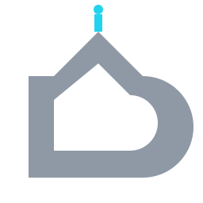

<div align="center">
  
</div>

<h1 align="center">⚡ cyberd4ch ⚡</h1>

```yaml
whoami:
  role: engineer → telecom & cybersecurity
  stack: [typescript, node, c, python]
  toolkit: [nextjs, docker, postgres, hasura]   # things I reach for
  focus: "npm supply-chain security — dependency trees as attack surfaces"
  method: "keep trying until it actually works — then make sure it keeps working"
```

Telecom engineering grad who zigzagged through **electrical panels, RF/microwave and IT** before
landing on code. I build full-stack systems (**Next.js / TypeScript**), deploy them into
containers & VMs to learn what breaks — and why — and spend research hours on
**supply-chain security, forensics, and cloud infrastructure**. Physical layer up to cloud:
if it moves bits, I want to know where they leak. 📡

<br>

<div align="center">
  <a href="https://github.com/cyberd4ch"></a>
  <a href="mailto:cyberdachh@proton.me"></a>
  <a href="https://github.com/cyberd4ch"></a>
</div>

<br>

## 🚀 What I'm building

| project | what it does | stack | |
|---|---|---|---|
| **[txn-agent](https://github.com/cyberd4ch/txn-agent)** | Safety-first transaction layer for purchasing agents: deterministic policy gates, human approvals, idempotent checkout | `Python` | ★ 2 |
| **[cportscan](https://github.com/cyberd4ch/cportscan)** | fast, lightweight port scanner in C — raw sockets, multithreaded sweeps, minimal overhead | `C · POSIX sockets` | |
| **[stride-tmr](https://github.com/cyberd4ch/stride-tmr)** | STRIDE threat modelling with `pytm` — turn designs into diagrams & findings | `Python` | |
| **[free-torrent-cli](https://github.com/cyberd4ch/free-torrent-cli)** | simple torrent client for the terminal, built on Node.js | `Node.js` | ★ 2 |

<br>

## 🎯 Current obsessions

- **supply-chain forensics** — my master's thesis: *how* and *why* npm dependency trees become liabilities. Breach post-mortems → what a pipeline should have caught.
- **cloud-native plumbing** — Docker, virtualization, and bridging the gap between "it works on my machine" and "it works under prod traffic."
- **forensic mindset applied to code** — hunting anomalies in data flow & access control, not just shipping features that pass tests.

<br>

## 🧰 The toolbox

<div align="center">

<p><strong>languages</strong></p>

<p>   </p>

<p><strong>frameworks &amp; runtime</strong></p>

<p>  </p>

<p><strong>infrastructure &amp; data</strong></p>

<p>    </p>

</div>

<br>

## 📊 The scoreboard

<p align="center">
  
  
</p>
<p align="center">
  
</p>

<br>

## 💥 Let's build something

Open to collaborating at the intersection of **security research, cloud infrastructure,
and full-stack development** — especially projects that involve breaking (and fixing) stuff.

📋 → [cyberdachh@proton.me](mailto:cyberdachh@proton.me)

