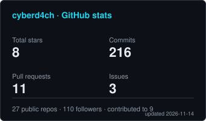
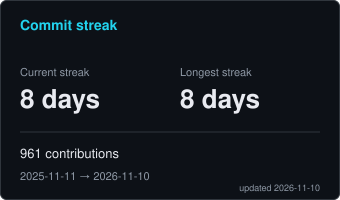
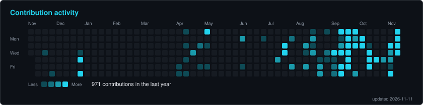
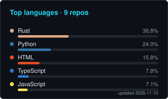
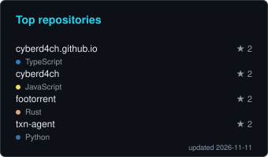

<h1 align="center">
  <picture>
    <source media="(prefers-color-scheme: dark)" srcset="https://raw.githubusercontent.com/cyberd4ch/cyberd4ch/main/assets/mark-light.svg" />
    
  </picture>
  cyber.dach
</h1>

  ×  
  

 

  
  
  
  

  <a href="https://cyberd4ch.github.io/projects/"><code>projects</code></a> ·
  <a href="https://cyberd4ch.github.io/blog/"><code>transmissions</code></a> ·
  <a href="https://cyberd4ch.github.io/freelance/"><code>services</code></a>

 

<strong>languages</strong>

    

<strong>frameworks &amp; runtime</strong>

  

<strong>infrastructure &amp; data</strong>

       

 

  
  

  

  
  

 

## // now building

**[getmocha.world](https://github.com/cyberd4ch/getmocha)** — remote job matching that ranks
postings before the crowd, then writes your application documents from your own answers:
screening questionnaires, CV reads with an honest percentage, cover letters + application emails.
Built fail-soft by contract — every AI path has a deterministic fallback, so the product never
breaks when the model dies. Kept honest by countables: a real-server jest suite (105 tests
across 18 suites), a 62-check HTTP acceptance battery against the live engine, and a browser
probe that walks the auth + apply flow on every verify.

## // security research

I document the work, including the negatives:

- **[security-toolkit](https://github.com/cyberd4ch/security-toolkit)** — MIT, dependency-free tools for nonce-laundering XSS: a bundle scanner (`nonce_scan.py`) and a rate-limited recon fetcher.
- **Nonce-laundering trace** — traced a server value into a nonce'd inline script in an authorized commerce program, then proved the server sanitised it. [write-up](https://cyberd4ch.github.io/blog/deeplink-gadget-trace/)
- **Basecamp / HEY recon** — the public marketing surface ships no CSP nonce at all; the testable class lives in the authenticated app. [program landscape](https://cyberd4ch.github.io/blog/bounty-program-landscape/)
- **Available for scoped security review** — fixed-scope JS/CSP/auth reviews with evidence-backed reports. [services](https://cyberd4ch.github.io/freelance/)

## // upstream bugs found & fixed

| repo | report | outcome |
|---|---|---|
| **[ppggff/vagrant-qemu](https://github.com/ppggff/vagrant-qemu/issues/96)** | provider reported `stopped` while the QEMU process was alive, once the tmp-dir pidfile vanished | **fixed in 0.8.0** — runtime state moved into a project-local run dir; migrated and verified on both of my VMs |
| **[waydroid/waydroid](https://github.com/waydroid/waydroid/issues/2472)** | LXC `mount (rw, move)` denied by AppArmor blocks container start on kernel 7.x | open — awaiting maintainer input |

 

## // payload manifest

<!-- projects:start -->
| project | what it does | stack | |
|---|---|---|---|
| **[footorrent](https://github.com/cyberd4ch/footorrent)** | A BitTorrent client in one ~3 MB Rust binary: full CLI, local web UI, prebuilt for macOS, Linux and Windows. Write-up: cyberd4ch.github.io/blog/footorrent-3-5-0-magnets-that-work/ | `Rust` | ★ 2 |
| **[txn-agent](https://github.com/cyberd4ch/txn-agent)** | Safety-first transaction layer for purchasing agents: deterministic policy gate, human approvals, idempotent checkout | `Python` | ★ 2 |
| **[security-toolkit](https://github.com/cyberd4ch/security-toolkit)** | Dependency-free tools for finding nonce-laundering XSS: a bundle scanner and a safe, rate-limited recon fetcher. | `Python` |  |
| **[stride-tmr](https://github.com/cyberd4ch/stride-tmr)** | STRIDE threat modelling with pytm — worked examples that turn attack-surface lists into ranked, testable threats. | `Python` |  |
| **[cportscan](https://github.com/cyberd4ch/cportscan)** | A minimal TCP port scanner written in C — raw sockets, connect timeouts, clean CLI. Learning project. | `HTML` |  |

auto-synced from GitHub on 2026-11-12 — edit the repo description, not this table.
<!-- projects:end -->

 

## // recently shipped

**Footorrent 3.5.0** — rebuilding the magnet path end to end. Metadata is now fetched and
verified before anything touches disk, so the window shows the real name, size and file list,
then asks where to save. Along the way: a BEP 10 reply read from the wrong extension id, a
handshake that rejected peers for routine chatter, and a download that re-announced to the
magnet's own dead tracker list instead of using the 200-plus peers resolve had already found.
Dead announce lists fall back to public trackers, peers are sampled in parallel batches, and
the UI shows per-peer rates, a tracker-fallback note and a retry button.

Measured on a magnet whose own trackers were all dead: resolve in 17–42 s, 129,302,391 bytes
and 11 files reported before writing, then 917 KB downloaded in the first minute across 6 peers.

→ [Source](https://github.com/cyberd4ch/free-torrent-cli) · [Release notes](https://github.com/cyberd4ch/free-torrent-cli/blob/main/CHANGELOG.md) · [Write-up](https://cyberd4ch.github.io/blog/footorrent-3-5-0-magnets-that-work/)

 

## // in the lab

Practice work that runs on a real machine, not in a slide deck. Every lab carries its own
README — goal, run steps, teardown, and an exercise log of what was actually executed,
including the parts that failed first.

| lab | what it taught me | state |
|---|---|---|
| **three-tier on Compose** | nginx → Flask → Postgres, one published port, secrets in a gitignored `.env` | running |
| **the same app on kind** | Deployments, Services, a replicated API, Postgres in-cluster; a `KeyError` crashloop and the secret that is a bag of keys | green |
| **observability layer** | metrics-server, kube-state-metrics, Prometheus, Grafana, postgres-exporter; an alert fired on purpose with a crash pod, then resolved itself after deletion | 0 firing |
| **Terraform, Docker provider** | plan before apply, state as the source of truth, drift and `import` made visible, a `destroy` that leaves nothing | exercises 1–5 |
| **remote state** | state migrated to S3 with SSE, versioning and `use_lockfile` locking; a planted lock object made a second operation refuse to start | done |
| **provider swap** | a bucket and its versioning declared with `hashicorp/aws` — same verbs, different graph; drift introduced by hand, repaired by `apply` | done |

Access for all of it is scoped: a dedicated IAM user limited to `arn:aws:s3:::ftc-labs-*`,
with **no root access keys anywhere**, and the policy proven against a denied request
instead of assumed.

 

## // transmissions

The full feed lives at **[cyberd4ch.github.io/blog](https://cyberd4ch.github.io/blog/)**.

<!-- writing:start -->
- **[Server-side trace of the deeplink gadget: positive and negative findings](https://cyberd4ch.github.io/blog/deeplink-gadget-trace/)** — The deeplink gadget in Mercado Libre's home component D interpolates server-rendered deeplink and redirectUrl values into single-quoted JavaScript inside a nonce'd script. Verified against the saved bundle: a mobile User-Agent flips openInApp.shouldRedirect and mounts it anonymously — but a quote nulls redirectUrl, non-UUID d2id nulls deeplink, and </script> is edge-blocked. Sink confirmed, sanitiser confirmed, no execution.
- **[Dead end with test accounts and researching a workaround](https://cyberd4ch.github.io/blog/deeplink-test-account-deadend/)** — The ATO 2FA challenge test account (userId 1252539217, CHALLENGE_ATO_USER_2, site MCO) returns 302 /login/identification/not-found, suggesting it is expired or removed. Later work showed the deeplink gadget mounts anonymously for mobile UA (and is sanitised), so the account blocker now applies to the seller / second-order path. Workaround paths: seller accounts, personal account (one only, no mass creation), or waiting for program test-user rollout.
- **[where the deeplink work can make money — and the reporting trap that kills it](https://cyberd4ch.github.io/blog/bounty-program-landscape/)** — Desk research on which programs pay for nonce-laundering XSS: Basecamp/HEY on HackerOne ($100-$10,000, with a 2026 cross-account nonce-bypass chain already disclosed) is the closest fit; Intigriti only has Lightspark and Adobe paying publicly. The trap: "CSP headers" is out of scope, but "XSS despite CSP" is not.
- **[magnets that actually work: three wire bugs, a dead tracker list, and 917 KB that finally moved](https://cyberd4ch.github.io/blog/footorrent-3-5-0-magnets-that-work/)** — footorrent 3.5.0 — metadata before disk, a bep 10 reply read from the wrong mailbox, peers discarded at the start line, and the measured numbers after the fix.
<!-- writing:end -->

 

## // recent

<!-- activity:start -->
- [pushed to cyberd4ch/cyberd4ch](https://github.com/cyberd4ch/cyberd4ch/commits) · `2026-11-11`
- [pushed to cyberd4ch/cyberd4ch.github.io](https://github.com/cyberd4ch/cyberd4ch.github.io/commits) · `2026-11-11`
- [commented on #114 in canonical/cos-alerter](https://github.com/canonical/cos-alerter/pull/114#issuecomment-6771948617) · `2026-11-10`
- [commented on #111 in canonical/cos-alerter](https://github.com/canonical/cos-alerter/pull/111#issuecomment-6771858572) · `2026-11-10`
<!-- activity:end -->

 

## // sponsor

If `dns-watch`, `txn-agent`, or anything else here saves you time, you can fund the work at
**[github.com/sponsors/cyberd4ch](https://github.com/sponsors/cyberd4ch)**. Sponsorship pays
for the lab VMs, API quotas, and the time behind the write-ups.

 

## // collaborate

Open to collaborating at the intersection of **security research, cloud infrastructure,
and full-stack development** — especially projects that involve breaking (and fixing) stuff.

📋 → [cyberdachh@proton.me](mailto:cyberdachh@proton.me)

 

  sig ● nominal · uplink: <a href="https://cyberd4ch.github.io/">cyberd4ch.github.io</a>

